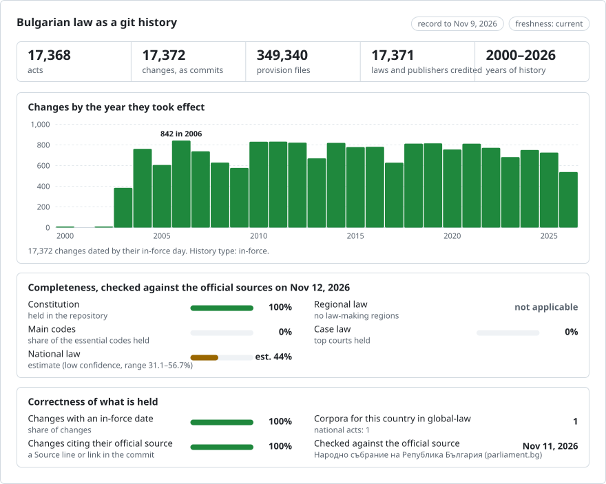

# Bulgaria: law history in git

**English** · **[Или прочетете на български](README.md)**

<picture>
<source media="(prefers-color-scheme: dark)" srcset="data/effort-dark.svg">

</picture>

The law of Bulgaria as a git history: one file per provision, one commit per version on the day it took effect, and the act that made each change as the commit's author. `git blame` names the act behind every provision; `git log` lists every change to an article; picking a date gives the text in force that day.

Part of [lexifina/global-law](https://github.com/lexifina/global-law), one git history for every country's law: this is Bulgaria's national law, which global-law reads at `bulgaria/national/acts/`.

**What is in it now:** the Constitution, with 4 versions from 2008, and 17,367 acts as published in the Държавен вестник (State Gazette) from 2003 to 2026: 2,601 laws and 3 codes, 7,370 Council of Ministers decrees, 6,095 ordinances, 857 rules and 441 instructions, 8,428 of them amending acts. Each of these acts has one version, its text as enacted. [`ACTS.md`](ACTS.md) lists every act, by kind, with its status.

Each act is in `<kind>/<year>/dv<issue>-<material>/`, named by its State Gazette issue and material number (`kodeks/2011/dv009-10005/` is the Изборен кодекс, the Electoral Code, ДВ бр. 9/2011); the Constitution is in `konstitutsiya/`, one file per article (`art-091-01.md` is чл. 91а). `data/paths.json` maps each act id to its folder.

The text is in Bulgarian (Cyrillic), as the National Assembly and the State Gazette publish it. An English translation is not part of this record.

## Questions as git commands

| Question | Command |
| --- | --- |
| Every change to Article 129 of the Constitution | `git log -p --word-diff -- konstitutsiya/art-129.md` |
| Which act wrote each line of Article 129? | `git blame konstitutsiya/art-129.md` |
| Every version of the Constitution, with the day each took effect | `git log --format="%h %(trailers:key=In-force,valueonly,separator=) %an" --author=parliament.invalid -- konstitutsiya` |
| Article 129 as in force on 1 January 2020 | `python tools/on.py 2020-01-01 konstitutsiya 129` |

**Outside git**, we also host this record publicly, for free:

- **[Ask Claude about Bulgarian law](https://global-law.lexifina.com/v1/try_claude?country=bulgaria)**: opens Claude with a first question ready.
- **[Ask ChatGPT](https://global-law.lexifina.com/v1/try_chatgpt?country=bulgaria)**: the same question in ChatGPT.
- **[Call the API in your browser](https://global-law.lexifina.com/v1/search_law?query=%D0%B3%D0%BE%D0%B4%D0%B8%D1%88%D0%B5%D0%BD+%D0%BE%D1%82%D0%BF%D1%83%D1%81%D0%BA&jurisdictions=bulgaria)**: a search of Bulgarian law for "годишен отпуск", returned as JSON. See the [documentation here](https://lexifina.com/api/global-law).

Both assistants read the record through the free Global law connector (MCP, `https://global-law.lexifina.com/mcp`); the first time, the chat gives you the link that adds it. Ask in Bulgarian or in English.

**Host it yourself easily.** All it takes is git and Python, and the tools run on your machine:

```sh
git clone --depth 1 https://github.com/lexifina/global-law && cd global-law
python3 tools/countries.py add bulgaria/national/acts
python3 tools/law.py show 2026-01-01 bulgaria/national/acts/konstitutsiya/art-129.md
```

Opened in Claude Code, Cursor, VS Code or Codex, the clone also starts a local MCP server with the same tools ([MCP.md](https://github.com/lexifina/global-law/blob/main/MCP.md)).

## Dates

Each commit is dated at noon, Europe/Sofia, on the day the version took effect, and carries it in its `In-force:` trailer:

- the day the act's own final provisions name; where they give some provisions a different day, the whole text is dated by its general day, and its commit says so;
- otherwise three days after the act's State Gazette day (Constitution, чл. 5, ал. 5; for Constitutional Court decisions, чл. 151, ал. 2), as the Gazette's own pages print that day;
- the Constitution's oldest version is dated 1 January 2008, when the last parts of the 2007 amendment took effect; its later versions take effect three days after ДВ бр. 100/2015, бр. 106/2023 and бр. 66/2024.

Each act is the author of its own commit (`zakon-2025-dv095-166613@parliament.invalid`). In the Constitution, a change is credited to the amending law or Constitutional Court decision only where the National Assembly's note on that provision names its Gazette issue; the oldest version and five edits no note explains are credited to the National Assembly as publisher.

## How it is checked

- Laws are the National Assembly's adopted final text (the Gazette's where its record has none), and other acts the State Gazette's official section as printed; the President's decree, signatures and editorial notes are cut, and only spacing, quotes and dashes are normalised.
- An act is published only when it reads cleanly (its provisions split with no gaps or repeats, its Gazette day and in-force day readable); the rest are held back, with the reason, in `data/held.json`.
- The Constitution's earlier texts come from Internet Archive captures of the National Assembly's page and go through the same parser as today's text, so a site redesign is not taken for a change of law.
- `tools/build/check_repo.py` reads every version back from git and compares it with the corpus, and the same corpus gives the same commit hashes; [`REPRODUCE.md`](REPRODUCE.md) records the corpus and builder hashes, and says these checks have not yet been run on the current build. There are no merge commits on `main`.

## What it does not show

- **Consolidated texts.** Apart from the Constitution, each act is its text as enacted: amendments are acts of their own, not merged into the acts they change. 2,039 acts are labelled "amended, not consolidated" and 161 "repealed, not consolidated" (`data/acts.json`).
- **Most codes and older law.** Of the codes, only the Кодекс на международното частно право, the Изборен кодекс and the Кодекс за застраховането are here; the Labour Code, the Penal Code and the other main codes are not. Nothing older than the State Gazette of 2003 is here, apart from the Constitution.
- **Every act of 2003 to 2026.** 4,674 acts in scope are held back because they do not read cleanly (`data/held.json`), and acts naming people (appointments, awards) are not taken. 21 acts published but not yet in force are listed in `data/pending.json` and appended on the day they take effect.
- **Annexes printed only in the Gazette's PDF**; the version's note says so.
- **The Constitution before 2008** (the 1991 text and the versions of 2003 to 2007), and the 2023 wording of 14 provisions the Constitutional Court ruled on in 2024: from 2023-12-25 to 2024-08-09 they read "[Източникът не дава текста, действащ на тази дата.]".
- **Case law, local acts and EU law.**

## Sources

| Source | Kind | Past versions | Notes |
| --- | --- | --- | --- |
| [Народно събрание: приети закони](https://www.parliament.bg/bg/laws) | Laws as adopted (final text) | no: the text as adopted | 2,032 laws and 2 codes |
| [Държавен вестник](https://dv.parliament.bg/DVWeb/) | Official gazette, official section | no: each act as printed | 15,333 acts: decrees, ordinances, rules, instructions, and laws the National Assembly's record has no text for; the Gazette day of every issue |
| [Народно събрание: Конституция](https://www.parliament.bg/bg/const) | The consolidated Constitution | no: today's text only | A note on each changed paragraph names its Gazette issue |
| [Internet Archive](https://web.archive.org/) | Captures of parliament.bg/bg/const | yes, as captured | The Constitution's versions of 2008 and 2015 |

## Licence

See [`LICENSE`](LICENSE). Official legal texts are not subject to copyright in Bulgaria (Закон за авторското право и сродните му права, чл. 4, т. 1), and Lexifina makes no claim to them. The history, commit messages, tables and tools are CC0 1.0.

No AI model wrote or changed legal text; the scripts were written by an AI model (see [`REPRODUCE.md`](REPRODUCE.md)).

## More

From [lexifina/global-law](https://github.com/lexifina/global-law):

- [FEATURES.md](https://github.com/lexifina/global-law/blob/main/FEATURES.md): every feature, and what every corpus must support (`git blame`, `law.py`, the MCP tools)
- [FAQ.md](https://github.com/lexifina/global-law/blob/main/FAQ.md): questions and answers · [CONTRIBUTING.md](https://github.com/lexifina/global-law/blob/main/CONTRIBUTING.md): proposing changes · [MCP.md](https://github.com/lexifina/global-law/blob/main/MCP.md): the MCP server · [REPRODUCE.md](https://github.com/lexifina/global-law/blob/main/REPRODUCE.md): how it was built · [CHANGELOG.md](https://github.com/lexifina/global-law/blob/main/CHANGELOG.md)
- [FRESHNESS.md](https://github.com/lexifina/global-law/blob/main/FRESHNESS.md): how current each corpus is · [Monitoring](https://github.com/lexifina/global-law/tree/main/monitoring): whether updates are running · [WATCHING.md](https://github.com/lexifina/global-law/blob/main/WATCHING.md): how each official source is watched for changes
- [performance/](https://github.com/lexifina/global-law/tree/main/performance): how fast the tools are, measured
- [visualisations/](https://github.com/lexifina/global-law/tree/main/visualisations): charts and bridges across the world's law
- [Vulnerabilities](https://github.com/lexifina/global-law/tree/main/vulnerabilities): mistakes in legislation as published
