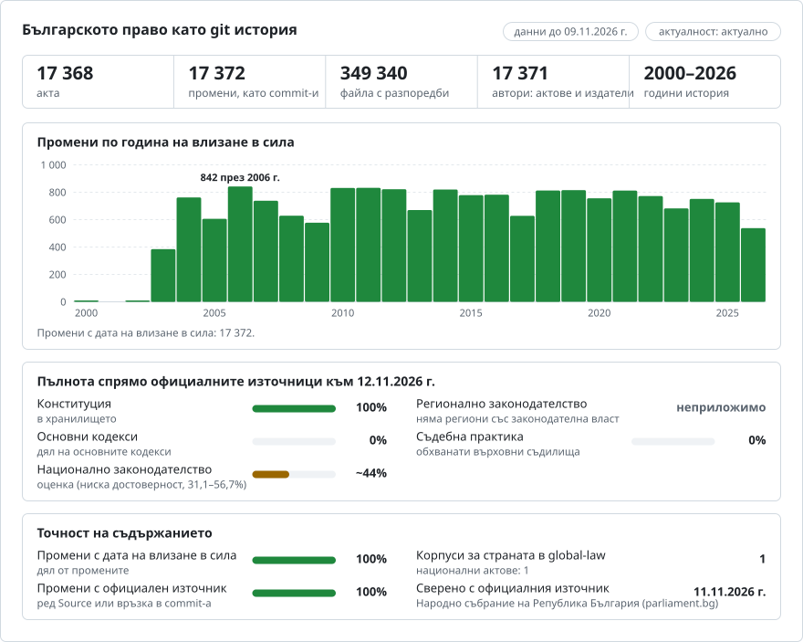

# България: историята на правото в git

**Български** · **[Or read it in English](README.en.md)**

<picture>
<source media="(prefers-color-scheme: dark)" srcset="data/bg/effort-dark.svg">

</picture>

Правото на България като история в git: по един файл за всяка разпоредба, по един commit за всяка редакция на деня, в който е влязла в сила, и актът, извършил всяка промяна, като автор на commit-а. `git blame` посочва акта зад всяка разпоредба; `git log` изброява всички промени на даден член; изборът на дата дава текста, действащ на този ден.

Част от [lexifina/global-law](https://github.com/lexifina/global-law), обща история в git за правото на всички държави: това е националното право на България, което global-law чете в `bulgaria/national/acts/`.

**Какво съдържа сега:** Конституцията, с 4 редакции от 2008 г.; 20-те кодекса в `kodeks/` (текстът на всеки е описан в [Какво не показва](#какво-не-показва)); и актове така, както са обнародвани в „Държавен вестник“ от 2003 до 2026 г.: 2778 закона, 7538 постановления на Министерския съвет, 6168 наредби, 967 правилника, 471 инструкции, 292 решения, 63 указа и 9 други акта, общо 18 307 акта заедно с Конституцията и кодексите. Повечето актове имат една редакция: текста си при приемането; от 17 368-те акта от първото изграждане, изброени в [`ACTS.md`](ACTS.md) със статуса на всеки, 8428 са изменящи актове. Съдебна практика: 54 решения, обнародвани в „Държавен вестник“ през 2026 г. (`caselaw/2026/`), 1426 акта на Върховния административен съд (`caselaw/vas/`) и над 1,09 милиона записа от публичните регистри на актовете на 171 съда от 2007 до 2022 г. (`caselaw/courts/`: данните от регистъра с връзка към официалния файл на акта, без текста му).

Всеки акт е в `<вид>/<година>/dv<брой>-<материал>/`, по броя на „Държавен вестник“ и номера на материала (`kodeks/2011/dv009-10005/` е Изборният кодекс, ДВ бр. 9/2011); Конституцията е в `konstitutsiya/`, по един файл за всеки член (`art-091-01.md` е чл. 91а). `data/paths.json` свързва идентификатора на всеки акт с папката му.

Текстът е на български (кирилица), така както го публикуват Народното събрание и „Държавен вестник“. Превод на английски не е част от този запис.

## Въпроси като команди на git

| Въпрос | Команда |
| --- | --- |
| Всички промени на чл. 129 от Конституцията | `git log -p --word-diff -- konstitutsiya/art-129.md` |
| Кой акт е написал всеки ред от чл. 129? | `git blame konstitutsiya/art-129.md` |
| Всички редакции на Конституцията, с деня, в който всяка е влязла в сила | `git log --format="%h %(trailers:key=In-force,valueonly,separator=) %an" --author=parliament.invalid -- konstitutsiya` |
| Чл. 129 в действащата редакция към 1 януари 2020 г. | `python tools/on.py 2020-01-01 konstitutsiya 129` |

**Извън git** публикуваме този запис и публично, безплатно:

- **[Попитайте Claude за българското право](https://global-law.lexifina.com/v1/try_claude?country=bulgaria)**: отваря Claude с готов първи въпрос.
- **[Попитайте ChatGPT](https://global-law.lexifina.com/v1/try_chatgpt?country=bulgaria)**: същият въпрос в ChatGPT.
- **[Търсете в българското право на нашия сайт](https://lexifina.com/law?country=bulgaria&q=%D0%B3%D0%BE%D0%B4%D0%B8%D1%88%D0%B5%D0%BD+%D0%BE%D1%82%D0%BF%D1%83%D1%81%D0%BA)**: търсене на „годишен отпуск“, с текста на всяка разпоредба и нейните редакции, без регистрация.
- **[REST API за разработчици](https://global-law.lexifina.com/v1/search_law?query=%D0%B3%D0%BE%D0%B4%D0%B8%D1%88%D0%B5%D0%BD+%D0%BE%D1%82%D0%BF%D1%83%D1%81%D0%BA&jurisdiction=bulgaria)**: същото търсене като JSON, без ключ. Документацията е [тук](https://lexifina.com/api/global-law).

И двата асистента четат записа чрез безплатния конектор Global law (MCP, `https://global-law.lexifina.com/mcp`); първия път чатът ви дава връзката, с която конекторът се добавя. Питайте на български или на английски.

**Лесно го пуснете сами.** Достатъчни са git и Python, а инструментите работят на вашия компютър:

```sh
git clone --depth 1 https://github.com/lexifina/global-law && cd global-law
python3 tools/countries.py add bulgaria/national/acts
python3 tools/law.py show 2026-01-01 bulgaria/national/acts/konstitutsiya/art-129.md
```

Отворено в Claude Code, Cursor, VS Code или Codex, копието стартира и локален MCP сървър със същите инструменти ([MCP.md](https://github.com/lexifina/global-law/blob/main/MCP.md)).

## Дати

Всеки commit е датиран по обяд, софийско време (Europe/Sofia), на деня, в който редакцията е влязла в сила, и носи този ден в трейлъра си `In-force:`:

- денят, който посочват заключителните разпоредби на самия акт; когато те дават на някои разпоредби друг ден, целият текст е датиран с общия ден и commit-ът му го отбелязва;
- иначе три дни след деня на броя на „Държавен вестник“ (Конституция, чл. 5, ал. 5; за решенията на Конституционния съд чл. 151, ал. 2), така както собствените страници на вестника отпечатват този ден;
- най-старата редакция на Конституцията е датирана 1 януари 2008 г., когато влизат в сила последните части от изменението от 2007 г.; по-късните ѝ редакции влизат в сила три дни след ДВ бр. 100/2015, бр. 106/2023 и бр. 66/2024.

Всеки акт е автор на собствения си commit (`zakon-2025-dv095-166613@parliament.invalid`). В Конституцията промяната се приписва на изменящия закон или на решението на Конституционния съд само когато бележката на Народното събрание към тази разпоредба посочва неговия брой на „Държавен вестник“; най-старата редакция и пет промени, които никоя бележка не обяснява, се приписват на Народното събрание като издател.

## Как се проверява

- Законите са окончателният приет текст на Народното събрание (текстът от „Държавен вестник“, когато записът му няма такъв), а другите актове са официалният раздел на „Държавен вестник“ така, както е отпечатан; указът на президента, подписите и редакционните бележки са премахнати, а са уеднаквени само интервалите, кавичките и тиретата.
- Актът се публикува само ако се чете чисто (разпоредбите му се разделят без пропуски и повторения, денят на броя и денят на влизане в сила се разчитат); останалите се задържат, с причината, в `data/held.json`.
- По-ранните текстове на Конституцията идват от копия в Internet Archive на страницата на Народното събрание и минават през същия парсер като днешния текст, така че ново оформление на сайта не се приема за промяна на правото.
- `tools/build/check_repo.py` прочита всяка редакция обратно от git и я сравнява с корпуса, а един и същ корпус дава едни и същи хешове на commit-ите; [`REPRODUCE.md`](REPRODUCE.md) записва хешовете на корпуса и на инструментите за изграждане и посочва, че тези проверки още не са пуснати за текущото изграждане. В `main` няма merge commit-и.
- [vulnerabilities/](vulnerabilities/): възможни грешки при изготвянето на българските нормативни актове, открити от детекторите на global-law и проверени ръчно.

## Какво не показва

- **Консолидирани текстове.** Освен Конституцията и четирите консолидирани кодекса по-долу, всеки акт е текстът му при приемането: измененията са самостоятелни актове и не са вписани в актовете, които променят. 2039 акта са отбелязани „amended, not consolidated“ (изменен, не е консолидиран) и 161 „repealed, not consolidated“ (отменен, не е консолидиран) (`data/acts.json`).
- **Пълната история на кодексите и по-старото право.** Кодексите са в `kodeks/` (20 папки). Наказателният кодекс (`kodeks/1968/dv026-nk/`) и Кодексът на труда (`kodeks/1986/dv026-kt/`) са консолидираните текстове на Министерството на правосъдието, до ДВ бр. 55/2026 и бр. 99/2026 (7 члена на Кодекса на труда се различават между двете проверени официални копия); Кодексът за социално осигуряване (`kodeks/1999/dv110-65242/`) е консолидираният текст на Националния осигурителен институт, до ДВ бр. 68/2026; Кодексът на търговското корабоплаване (`kodeks/1970/dv055-ktk/`) е консолидираният текст на Морска администрация, до ДВ бр. 16/2026 (само едно официално копие). Наказателно-процесуалният кодекс, Данъчно-осигурителният процесуален кодекс, Административнопроцесуалният кодекс, Гражданският процесуален кодекс, Семейният кодекс, Кодексът за застраховането от 2005 г. и Изборният кодекс от 2014 г. са текстът им при приемането, а по-късните изменящи актове се добавят като отделни commit-и (засега не всички); Кодексът на международното частно право, Изборният кодекс от 2011 г. и Кодексът за застраховането от 2015 г. са по един текст при приемането; шест международни морски кодекса (2021 г.) са във вида, в който са обнародвани. Кодексите от 1968, 1970, 1986 и 1999 г. започват от днешния консолидиран текст: първоначалните им текстове и редакциите им преди 2003 г. не са достъпни онлайн от официален източник, а измененията от 1989 до 2002 г. не са изградени. Освен тези кодекси, Конституцията, съдебната практика и някои решения на Министерския съвет от 1989 г. (само данни от регистъра), нищо по-старо от „Държавен вестник“ от 2003 г. не е тук.
- **Всички актове от 2003 до 2026 г.** 4674 акта от обхвата са задържани, защото не се четат чисто (`data/held.json`), а актове, които назовават лица (назначения, награди), не се включват. 21 акта, обнародвани, но още невлезли в сила, са изброени в `data/pending.json` и се добавят на деня, в който влизат в сила.
- **Приложения, отпечатани само в PDF на броя**; бележката към редакцията го посочва.
- **Конституцията преди 2008 г.** (текстът от 1991 г. и редакциите от 2003 до 2007 г.), както и текстът от 2023 г. на 14 разпоредби, по които Конституционният съд се е произнесъл през 2024 г.: от 2023-12-25 до 2024-08-09 те гласят „[Източникът не дава текста, действащ на тази дата.]“.
- **По-голямата част от съдебната практика, местните актове и правото на ЕС.** Съдебната практика е само изброената по-горе (нищо от Върховния касационен съд, а регистрите на съдилищата дават данни за всеки акт, не текста му); местните актове са 58 документа на 14 институции в `local/`.

## Източници

| Източник | Вид | Предишни редакции | Бележки |
| --- | --- | --- | --- |
| [Народно събрание: приети закони](https://www.parliament.bg/bg/laws) | Закони във вида, в който са приети (окончателен текст) | не: текстът при приемането | 2032 закона и 2 кодекса |
| [Държавен вестник](https://dv.parliament.bg/DVWeb/) | Официален вестник, официален раздел | не: всеки акт така, както е отпечатан | 15 333 акта: постановления, наредби, правилници, инструкции и закони, за които записът на Народното събрание няма текст; датата на всеки брой; повечето актове и кодекси, добавени след първото изграждане |
| [Народно събрание: Конституция](https://www.parliament.bg/bg/const) | Консолидираната Конституция | не: само днешният текст | Бележка към всеки променен абзац посочва броя на „Държавен вестник“ |
| [Internet Archive](https://web.archive.org/) | Копия на parliament.bg/bg/const | да, както са заснети | Редакциите на Конституцията от 2008 и 2015 г. |
| [Министерство на правосъдието](https://mjs.bg) | Консолидирани текстове | не: само днешният текст | Наказателният кодекс и Кодексът на труда |
| [Национален осигурителен институт](https://nssi.bg) | Консолидирани текстове | не: само днешният текст | Кодексът за социално осигуряване; проверка на Кодекса на труда |
| [Изпълнителна агенция „Морска администрация“](https://www.marad.bg) | Консолидиран текст | не: само днешният текст | Кодексът на търговското корабоплаване |
| [Върховен административен съд](https://sac.justice.bg) | Съдебни актове | не | 1426 акта |
| Публични регистри на актовете на съдилищата (`<съд>.justice.bg`) | Данни от регистъра за съдебни актове | не | Над 1,09 милиона записа на 171 съда, без текста на актовете |

## Лиценз

Вижте [`LICENSE`](LICENSE). Официалните нормативни текстове не са обект на авторско право в България (Закон за авторското право и сродните му права, чл. 4, т. 1) и Lexifina не предявява права върху тях. Историята, съобщенията на commit-ите, таблиците и инструментите са под CC0 1.0.

Никой AI модел не е писал или променял нормативен текст; скриптовете са написани от AI модел (вижте [`REPRODUCE.md`](REPRODUCE.md)).

Това е превод на английската версия ([README.en.md](README.en.md)); ако двете се различават, предимство има английската версия.

## Визуализации

[visualisations/](visualisations/): Българското право в 20 графики, начертани от това хранилище.

Сред тях:

- Колко закона приема всяко Народно събрание, законодателният календар и кога влиза в сила държавният бюджет
- Как законите се изменят чрез други закони, най-често изменяните закони и кодекси, и Конституцията
- Постановленията на правителството, „Държавен вестник“, правото на ЕС в законите, ратифицираните договори и еврото

## Още

От хранилището [lexifina/global-law](https://github.com/lexifina/global-law) (на английски):

- [FEATURES.md](https://github.com/lexifina/global-law/blob/main/FEATURES.md): всички функции и какво трябва да поддържа всеки корпус (`git blame`, `law.py`, MCP инструменти)
- [FAQ.md](https://github.com/lexifina/global-law/blob/main/FAQ.md): въпроси и отговори · [CONTRIBUTING.md](https://github.com/lexifina/global-law/blob/main/CONTRIBUTING.md): предлагане на промени · [MCP.md](https://github.com/lexifina/global-law/blob/main/MCP.md): MCP сървър · [REPRODUCE.md](https://github.com/lexifina/global-law/blob/main/REPRODUCE.md): как е създадено · [CHANGELOG.md](https://github.com/lexifina/global-law/blob/main/CHANGELOG.md)
- [FRESHNESS.md](https://github.com/lexifina/global-law/blob/main/FRESHNESS.md): колко актуален е всеки корпус · [Мониторинг](https://github.com/lexifina/global-law/tree/main/monitoring): дали обновяванията работят · [WATCHING.md](https://github.com/lexifina/global-law/blob/main/WATCHING.md): как всеки официален източник се следи за промени
- [performance/](https://github.com/lexifina/global-law/tree/main/performance): колко бързи са инструментите, измерено
- [visualisations/](https://github.com/lexifina/global-law/tree/main/visualisations): графики и връзки в правото на целия свят
- [Уязвимости](https://github.com/lexifina/global-law/tree/main/vulnerabilities): грешки в актовете във вида, в който са обнародвани
