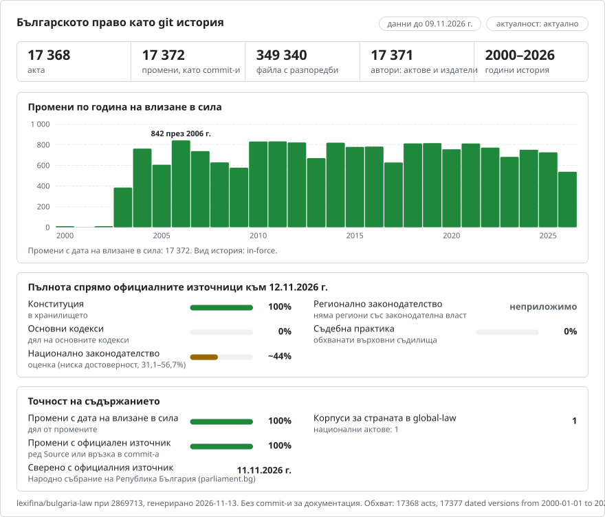

# България: историята на правото в git

**Български** · [English](README.en.md)

<picture>
<source media="(prefers-color-scheme: dark)" srcset="data/bg/effort-dark.svg">

</picture>

Част от [lexifina/global-law](https://github.com/lexifina/global-law), обща история в git за правото на всички държави: това е националното право на България, което global-law чете в `bulgaria/national/acts/`.

Правото на България като история в git: по един файл за всяка разпоредба, по един commit за всеки закон на деня, в който е влязъл в сила, и законът, извършил всяка промяна, като автор на commit-а. `git blame` посочва закона зад всеки абзац; `git log` изброява всички промени на даден член; инструментът по-долу дава текста, действащ на произволна дата.

Хранилището следва общия модел на [lexifina/global-law](https://github.com/lexifina/global-law), който го поставя в `bg/`.

**Какво съдържа сега: един акт, четири редакции, от 1 януари 2008 г. до днес.** Конституцията така, както я публикува Народното събрание: днешният текст от parliament.bg и два по-ранни текста от копията в Internet Archive на старата страница на Конституцията на сайта на Народното събрание (2010 до 2021 г.). Записът започва на 1 януари 2008 г. с най-стария текст, който архивът съдържа; текстът от 1991 г. и редакциите от 2003 до 2007 г. не са в него.

| Папка | Акт | Редакции | История |
| --- | --- | ---: | --- |
| `konstitutsiya/` | Конституция на Република България (1991) | 4 | От 2008-01-01 до днес: най-старата налична редакция, след това изменението от 2015 г., изменението от 2023 г. и Решение № 13 на Конституционния съд от 2024 г. |

| В сила от | Текст | Commit-и (автор) | Източник |
| --- | --- | --- | --- |
| 2008-01-01 | Текстът след измененията от 2003, 2005, 2006 и 2007 г. и Решение № 7 от 2006 г. | Най-старата налична редакция (издателят); съобщението на commit-а посочва шестте по-ранни обнародвания в „Държавен вестник“ | Копие в Internet Archive на parliament.bg/bg/const от 22 декември 2010 г. |
| 2015-12-21 | ЗИД, ДВ бр. 100 от 18.12.2015: 10 разпоредби, всяка отбелязана с „ДВ, бр. 100 от 2015 г.“ | `dv-2015-100` | Копие от 25 януари 2016 г. |
| 2023-12-25 | ЗИД, ДВ бр. 106 от 22.12.2023: 8 разпоредби. Още 14 разпоредби гласят „[Източникът не дава текста, действащ на тази дата.]“ (вж. по-долу), и 5 редакционни промени на издателя, които никоя бележка не обяснява | `dv-2023-106`; издателят, „необяснени“ | Днешният текст (API на parliament.bg) |
| 2024-08-09 | Решение № 13 на КС, ДВ бр. 66 от 06.08.2024: 14 разпоредби | `dv-2024-66` | Днешният текст (API на parliament.bg) |

Файловете са `konstitutsiya/art-NNN.md` за всеки член (член с буква получава номер: `art-091-01.md` е чл. 91а, `art-091-02.md` е чл. 91б, `art-130-01.md` до `art-130-03.md` са чл. 130а до 130в, `art-132-01.md` е чл. 132а); `preambyl.md` е преамбюлът; `art-NNN-0-heading-1.md` е заглавието на главата, която започва с този член (Глава първа до Глава десета); `prehodni-01.md` са собствените Преходни и заключителни разпоредби на Конституцията, а `prehodni-02.md` до `prehodni-06.md` са преходните разпоредби на изменящите закони от 2003, 2005, 2007, 2015 и 2023 г., така както Народното събрание ги отпечатва след Конституцията. Общо 192 файла: членове от 1 до 169, шестте члена с буква, преамбюлът, десет заглавия на глави и шест раздела с преходни разпоредби. `konstitutsiya/README.md` ги изброява.

**Деветте обнародвания в „Държавен вестник“ зад днешния текст.** Текстът на Народното събрание започва със списък на всяко обнародване и изменение в „Държавен вестник“. Първите шест са отпреди най-старата редакция тук и са посочени в нейния commit; последните три имат собствени commit-и:

| Ключ | „Държавен вестник“ | Какво представлява |
| --- | --- | --- |
| `dv-1991-56` | ДВ бр. 56 от 13.07.1991 | Конституцията, обнародвана и в сила от 13 юли 1991 г. |
| `dv-2003-85` | ДВ бр. 85 от 26.09.2003 | Закон за изменение и допълнение (ЗИД) на Конституцията |
| `dv-2005-18` | ДВ бр. 18 от 25.02.2005 | ЗИД на Конституцията |
| `dv-2006-27` | ДВ бр. 27 от 31.03.2006 | ЗИД на Конституцията |
| `dv-2006-78` | ДВ бр. 78 от 26.09.2006 | Решение № 7 на Конституционния съд от 2006 г. |
| `dv-2007-12` | ДВ бр. 12 от 06.02.2007 | ЗИД на Конституцията |
| `dv-2015-100` | ДВ бр. 100 от 18.12.2015 | ЗИД на Конституцията |
| `dv-2023-106` | ДВ бр. 106 от 22.12.2023 | ЗИД на Конституцията |
| `dv-2024-66` | ДВ бр. 66 от 06.08.2024 | Решение № 13 на Конституционния съд от 2024 г. |

В самия текст Народното събрание отбелязва всеки изменен абзац с бележка, която посочва броя на „Държавен вестник“: „(Нов - ДВ, бр. 27 от 2006 г.)“ при чл. 91а, „(Нова - ДВ, бр. 18 от 2005 г.)“ при една алинея на чл. 4, „(Изм. - ДВ, бр. 85 от 2003 г., изм. - ДВ, бр. 12 от 2007 г., отм. - ДВ, бр. 100 от 2015 г.)“ при чл. 131. Тези бележки са запазени в текста точно както са отпечатани, така че `git grep` намира всяка разпоредба, засегната от даден закон (вж. по-долу). Те са данните, по които историята определя авторството: изменена разпоредба се приписва на дадено обнародване само ако собствената ѝ бележка посочва броя на „Държавен вестник“ на това обнародване.

## Въпросите на юриста като команди на git

| Въпрос | Команда |
| --- | --- |
| Какво гласи чл. 5 днес? | `python tools/on.py 2026-10-29 konstitutsiya 5` |
| Член с буква (чл. 91а) | `python tools/on.py 2026-10-29 konstitutsiya art-091-01` |
| Същото, с посочване откъде идва текстът | `python tools/on.py --law 2026-10-28 konstitutsiya art-091-01` |
| Същото, само с git | `git show main:konstitutsiya/art-091-01.md` |
| Цялата Конституция днес | `python tools/on.py 2026-10-29 konstitutsiya` |
| Кои разпоредби според източника са засегнати от изменението от 2023 г.? | `git grep -l "бр. 106 от 2023" -- konstitutsiya/` |
| Всички бележки за изменения при чл. 129, както са отпечатани | `git grep -n "ДВ, бр" -- konstitutsiya/art-129.md` |
| Текстът на 1 януари 2020 г. | `python tools/on.py 2020-01-01 konstitutsiya` |
| Чл. 130а преди и след изменението от 2015 г. | `git diff konstitutsiya/2008-01-01 konstitutsiya/2015-12-21 -- konstitutsiya/art-130-01.md` |
| Кой закон е променил последно всеки ред на чл. 129? | `git blame konstitutsiya/art-129.md` |
| Всички промени на чл. 84 | `git log -p -- konstitutsiya/art-084.md` |
| Какво е променило изменението от 2015 г. | `git show law/dv-2015-100` (тагове `law/<key>`; редакциите имат тагове `konstitutsiya/<in-force day>`) |
| Шестте по-ранни обнародвания, посочени за най-старата редакция | `git log -1 --format=%B konstitutsiya/2008-01-01` |
| Промени, които никоя бележка не обяснява | `git log --author=ns@parliament.invalid` |
| Приети закони, които още не са в сила | `git log main..badeshte` (днес няма такива; клонът още не съществува) |

След повторно изграждане обновете таговете с `git fetch --force --tags`: обикновеният fetch запазва остарелите тагове.

## Дати

- Всеки commit е с дата **по обяд, часова зона Europe/Sofia, в деня, в който промяната е влязла в сила**. Денят на влизане в сила е посочен и в трейлъра `In-force:`, който инструментите четат.
- **Общо правило.** Конституцията, чл. 5, ал. 5: нормативните актове влизат в сила три дни след обнародването им в „Държавен вестник“, освен ако в тях е определен друг срок. Чл. 151, ал. 2: решенията на Конституционния съд влизат в сила три дни след обнародването им.
- **2015-12-21, 2023-12-25 и 2024-08-09** са датите на ДВ бр. 100/2015, бр. 106/2023 и бр. 66/2024 плюс три дни; никой от трите акта не определя собствена дата.
- **Най-старата редакция е с дата 1 януари 2008 г.** Текстът ѝ съдържа измененията до ДВ бр. 12/2007, а части от тях са влезли в сила на собствени дати, както ги отпечатва текстът: § 7 от закона от 2003 г. въвежда в сила § 1, т. 3 на 1 януари 2004 г.; § 7 от закона от 2005 г. въвежда в сила чл. 22 с Договора за присъединяване към ЕС (бележката: „в сила от 01.01.2007 г.“); § 13 от закона от 2007 г. въвежда в сила неговите §§ 1 и 2 (чл. 9 и 59) на 1 януари 2008 г. Следователно текстът е бил цялостен от 1 януари 2008 г. и нищо не го е променяло отново до 2015 г.
- **Копието в архива изостава.** Страницата на Народното събрание все още показва текста от 2007 г. на 16 януари 2016 г., а текста от 2015 г. – от 25 януари 2016 г. Редакциите са датирани по закона, а не по копието.

## Как се проверява

- **Днешният текст е официалният текст.** Кодът на Lexifina чете консолидираната Конституция на Народното събрание (един JSON отговор от parliament.bg, чийто sha256 се записва с редакцията) и я разделя на разпоредби без друга промяна освен нормализиране на интервалите, кавичките и тиретата. Налице са всички членове от 1 до 169, както и 91а, 91б, 130а, 130б, 130в и 132а. Копието в Internet Archive на същия отговор на API от 20 август 2025 г. е идентично байт по байт.
- **Един парсер за всички източници.** Старата страница (2010 г. до май 2021 г.) и днешният API минават през един и същ код, така че нов дизайн на сайта не се приема за промяна на правото. Проверката: старата страница, копирана на 6 май 2021 г., и API, копиран на 29 юни 2021 г., след новия дизайн, дават идентични разпоредби.
- **По едно копие за всеки различен текст.** Кодът на Lexifina --history` прочете 46 от 314-те копия на старата страница (първото за всяко тримесечие, след това разполовяване навсякъде, където две съседни копия се различават) и анализира всяко от тях. Всяко копие от 22 декември 2010 г. до 16 януари 2016 г. дава първия текст, всяко от 25 януари 2016 г. до 6 май 2021 г. – втория. Двете фиксирани копия са записани със своя sha256 във всяка редакция.
- **Всяка промяна е отчетена.** Всичките 10 промени от 2015 г., 8 от 2023 г. и 14 от 2024 г. имат бележка, посочваща броя на „Държавен вестник“. Пет малки редакционни промени на издателя нямат бележка и са записани като необяснени (вж. по-долу).
- Всяка редакция се прочита обратно от git в деня на влизането ѝ в сила и в предходния ден (`tools/check_repo.py`) и трябва да съвпада с `corpus.json`: 0 несъответствия. В `main` няма merge commit-и, датите на commit-ите никога не вървят назад, нищо не е с бъдеща дата и трейлърите на всеки commit се разчитат.
- Хранилището се изгражда повторно от същите данни и дава идентични хешове. Подробности в [`REPRODUCE.md`](REPRODUCE.md).

## Какво означава „автор“

Авторът на един commit е законът, който е извършил промяната, с имейл адрес, който не може да съществува, така че `git blame` и `git log --author` посочват закони. Committer винаги е Lexifina.

- **Commit-ите на законите** имат за автори `dv-2015-100`, `dv-2023-106` и `dv-2024-66` (`<key>@parliament.invalid`), по един commit за всяко обнародване в деня на влизането му в сила.
- **Commit-ите на издателя.** Първият commit има за автор Народното събрание на Република България (`ns@parliament.invalid`) и е означен като „най-старата налична редакция“; съобщението му посочва шестте по-ранни обнародвания, без да приписва който и да е ред на някое от тях. Издателят е автор и на единствения „необяснен“ commit, на 2023-12-25: 14-те разпоредби, които на тази дата съдържат заместващия текст, и петте редакционни промени, които никоя бележка не обяснява (чл. 9 и 59: „в сила от 1 януари 2008 г.“ става „01.01.2008 г.“; чл. 85, т. 8: точка става точка и запетая; чл. 91а: бележката му е слята с ал. 1; чл. 158, т. 5: „гл.“ става „глава“). Издателят е направил тези промени между 29 юни 2021 г. и 20 август 2025 г.; те са поместени в първата редакция, изградена от днешния текст.
- **Авторството идва само от източника.** Промяна се приписва на закон само ако бележката на Народното събрание към тази разпоредба го посочва.

## Какво не показва

Затова редакцията от 2023-12-25 е днешният текст, с тази разлика, че 14-те разпоредби, чиито бележки посочват Решение № 13 от 2024 г. (чл. 23, 84, 91б, 99, 110, 126, 129, 130, 130а, 130б, 130в, 132а, 133 и 150), гласят „[Източникът не дава текста, действащ на тази дата.]“. Текстът им се появява на 2024-08-09 и се приписва на решението. Следователно собствените думи на изменението от 2023 г. в тези разпоредби не са в записа.
- **Наказателният кодекс и Законът за защита на личните данни.** Нито един от двата не е изграден. Възможните източници – cpdp.bg (Комисията за защита на личните данни) за Закона за защита на личните данни и маршрутите на parliament.bg за приетите закони (`/act/<id>`, `/bill/<id>`) – все още не са проучени.
- **Други актове.** Тук е само Конституцията.
- **Текстът на отменени или обявени за противоконституционни разпоредби.** Когато разпоредба е отменена или Конституционният съд я е обявил за противоконституционна, файлът съдържа това, което отпечатва Народното събрание. `art-131.md` съдържа само бележката „(Изм. - ДВ, бр. 85 от 2003 г., изм. - ДВ, бр. 12 от 2007 г., отм. - ДВ, бр. 100 от 2015 г.)“; `art-091-02.md` (чл. 91б) съдържа бележката си „(Нов - ДВ, бр. 106 от 2023 г.; обявен за противоконституционен с РКС № 13 от 2024 г. - ДВ, бр. 66 от 2024 г.)“, а след нея обявения за противоконституционен текст между две линии от тирета, както го отпечатва Народното събрание.
- **Бележки в текста.** Тъй като бележките за измененията са запазени, текстът е изданието на Народното събрание, а не голият текст на закона. Бележките не са отделни единици.

Официален е само текстът, публикуван от Народното събрание и в „Държавен вестник“. Това хранилище е помощно средство за проучване, а не правен съвет.

## Как е изградено

Lexifina чете изброените тук източници и записва датираните редакции на всеки акт и законите, извършили всяка промяна, в един файл с корпуса. `tools/build.py` създава това хранилище от този файл и един и същ корпус винаги дава едни и същи хешове на commit-ите; `REPRODUCE.md` съдържа подробностите и проверките. Модел (Claude) е написал кода на Lexifina; той не е написал правен текст и при изграждането на историята не работи никакъв модел.

## Източници

| Източник | Какво дава | Датирани редакции | Посочва изменящия акт | Достъп и условия | Използван |
| --- | --- | --- | --- | --- | --- |
| [Народно събрание, Конституция](https://www.parliament.bg/bg/const) (API: `https://www.parliament.bg/api/v1/nav/bg/const`) | Официалната консолидирана Конституция | Не: само днешният текст | Да, бележка при всеки изменен абзац и пълният списък на обнародванията в заглавната част | JSON със съдържание в HTML. Официален нормативен текст, който не е обект на авторско право (Закон за авторското право и сродните му права, чл. 4, т. 1) | Да: днешният текст |
| [Държавен вестник](https://dv.parliament.bg) | „Държавен вестник“: законите във вида, в който са обнародвани | Няма консолидирани текстове | Частично | PDF. | Не |
| [lex.bg](https://lex.bg) | Консолидирани текстове (частни, неофициални) | | | – | Не: не е изтеглян |
| [Internet Archive](https://web.archive.org/) | Копия на parliament.bg/bg/const: пълният текст на старата страница от декември 2010 г. до май 2021 г., след това обвивката на JavaScript; отговорът на API на 29 юни 2021 г. и 20 август 2025 г. | Да, според копията | Както го отпечатват копията | – | Да: редакциите от 2008 и 2015 г. (копия 20101222212318 и 20160125101631) |
| – | Друг уеб архив | | | – | Не |

Регистърът, от който започна това хранилище, посочваше, че консолидирани текстове на българското право има само в частни услуги. За Конституцията това не е така: Народното събрание я публикува консолидирана, с бележките за измененията.

Ръководства за проучване, които обхващат всички държави: [GlobaLex](https://www.nyulawglobal.org/globalex/) и [Law Library of Congress Guide to Law Online](https://www.loc.gov/research-centers/law-library-of-congress/researcher-resources/guide-to-law-online/).

## Лиценз

Вж. [LICENSE](LICENSE). Текстът на Конституцията е официалният текст, публикуван от Народното събрание на Република България (parliament.bg). Официалните нормативни текстове не са обект на авторско право в България (Закон за авторското право и сродните му права, чл. 4, т. 1) и Lexifina не претендира за права върху него. Историята, съобщенията на commit-ите, таблиците и инструментите са предоставени при условията на [CC0 1.0](LICENSE).

Това е превод на английската версия ([README.en.md](README.en.md)); при разлики предимство има английската версия.

## Още

От хранилището [lexifina/global-law](https://github.com/lexifina/global-law) (на английски):

- [FEATURES.md](https://github.com/lexifina/global-law/blob/main/FEATURES.md): всички функции и какво трябва да поддържа всеки корпус (`git blame`, `law.py`, MCP инструменти)
- [FAQ.md](https://github.com/lexifina/global-law/blob/main/FAQ.md): въпроси и отговори · [CONTRIBUTING.md](https://github.com/lexifina/global-law/blob/main/CONTRIBUTING.md): предлагане на промени · [MCP.md](https://github.com/lexifina/global-law/blob/main/MCP.md): MCP сървър · [REPRODUCE.md](https://github.com/lexifina/global-law/blob/main/REPRODUCE.md): как е създадено · [CHANGELOG.md](https://github.com/lexifina/global-law/blob/main/CHANGELOG.md)
- [FRESHNESS.md](https://github.com/lexifina/global-law/blob/main/FRESHNESS.md): колко актуален е всеки корпус · [Мониторинг](https://github.com/lexifina/global-law/tree/main/monitoring): дали обновяванията работят · [WATCHING.md](https://github.com/lexifina/global-law/blob/main/WATCHING.md): как всеки официален източник се следи за промени
- [performance/](https://github.com/lexifina/global-law/tree/main/performance): колко бързи са инструментите, измерено
- [visualisations/](https://github.com/lexifina/global-law/tree/main/visualisations): графики и връзки в правото на целия свят
- [Уязвимости](https://github.com/lexifina/global-law/tree/main/vulnerabilities): грешки в актовете във вида, в който са обнародвани
