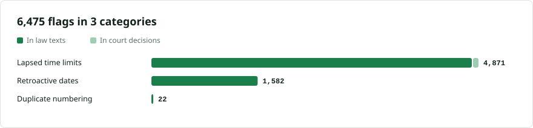

# Vulnerabilities in Bulgarian law

[Български](README.md) · **English**

<picture>
<source media="(prefers-color-scheme: dark)" srcset="img/flags-by-category-dark.svg">

</picture>

The vulnerability detectors from [lexifina/global-law](https://github.com/lexifina/global-law/tree/main/vulnerabilities) look for mechanical mistakes in legislation: a rule applying "until" a date that has passed, an act in force before it was published, a time limit extended only after it had run out, a reference to a section that no longer exists. global-law's published list (9 November 2026) did not cover Bulgaria, so this is a run over this repository only, as it stood at commit [`7257fc3`](https://github.com/lexifina/bulgaria-law/commit/7257fc34e4a84bf62d70f593aa9511cdea76ea81) on 15 November 2026, with the Constitution, the 17,367 acts from the State Gazette of 2003 to 2026, and the court decisions, drafts and consultation notices it also holds.

**In short:** the detectors raised 1,963 flags. A language model reviewed 80 of the strongest, arguing each one for and against; 13 survived. Checked by hand in this repository, one looks like a real drafting mistake, small and long spent. Instruction No. 8121з-282 of 2018 on service cards in the Ministry of the Interior let the 2016 hologram stickers be used until 30 June 2018, but the instruction it replaced allowed them only until 31 December 2017, and the new one took effect on its Gazette day, 23 March 2018, so for 81 days no rule allowed them. Of the other 12, 8 are Council of Ministers decrees whose own final provisions set a day before they were published (pay, the minimum wage, university funding, the 2026 budget), and 4 are spent transitional rules. The hand check also found that 49 laws are dated in this repository three days after their Gazette day, not on the day their own final provisions name. Later, this will be formalised in Lean, similar to our work on [the US tax code](https://lexifina.com/blog/formalizing-the-us-tax-code) and [US case law](https://lexifina.com/blog/formalizing-all-us-case-law-in-lean).

A flag is a prompt to look, not legal advice, and nothing here has been tested in court.

## Flags by category

| Category | What it looks for | Flags | In law texts | Reviewed | Survived review |
| --- | --- | ---: | ---: | ---: | ---: |
| Lapsed time limits | Text still applying a rule "until" a date that has passed | 355 | 267 | 40 | 5 |
| Retroactive or pre-publication dates | An act in force before it was made or published | 1,582 | 1,582 | 40 | 8 |
| Duplicate numbering | Two units with the same number in one act | 22 | 22 | 0 | 0 |
| Dead currencies | Amounts in currencies no longer in use | 4 | 4 | 0 | 0 |

"In law texts" counts laws and codes, Council of Ministers decrees, ordinances, rules, instructions, treaties and the other acts of the State Gazette's official section. The other flags are in decisions of the Constitutional Court and the Supreme Administrative Court, which this repository also holds, apart from its law, with drafts and consultation notices (these raised no flags). The search for repeal gaps, same-day conflicts, empty periods, stale amounts and references to deleted provisions found nothing to flag: apart from the Constitution, each act here has one version, its text as enacted, and amendments are acts of their own, so no provision is ever changed or removed in this history for those detectors to compare.

*Edge cases: the 13 flags that survived the review, grouped by what they turned out to be, and what the other flags are, in [EDGE-CASES.en.md](EDGE-CASES.en.md).*

## Problems found in this repository

- **Laws dated three days after the Gazette:** 49 laws whose final provisions say "Законът влиза в сила от ... с изключение на ..." are dated three days after their State Gazette day, not on the general day they name, which the "Dates" section of this repository's README says should be used. For 39 of them the named day is later, so the record shows them in force before they were; for 10 it is earlier, among them the state budget acts for 2022, 2023, 2025 and 2026, which take effect from 1 January but are dated here 7 March 2022, 4 August 2023, 30 March 2025 and 3 August 2026 (§ 48 of [the 2026 act](https://github.com/lexifina/bulgaria-law/blob/7257fc34e4a84bf62d70f593aa9511cdea76ea81/zakon/2026/dv069-167157/art-014.md)). Those 10 are therefore missing from the retroactive-date flags.
- **Articles left inside one file:** in 12 laws, the provisions after one article stay in that article's file: the state budget acts for 2014, 2015 and 2019 to 2026, the 2013 state social security budget act and the Закон за виното и спиртните напитки. In the 2026 budget act, [art-014.md](https://github.com/lexifina/bulgaria-law/blob/7257fc34e4a84bf62d70f593aa9511cdea76ea81/zakon/2026/dv069-167157/art-014.md) holds чл. 14 to чл. 115 and §§ 1 to 48; in the wine act, [art-123.md](https://github.com/lexifina/bulgaria-law/blob/7257fc34e4a84bf62d70f593aa9511cdea76ea81/zakon/2012/dv045-13789/art-123.md) holds чл. 123 to чл. 225.

## Files

| File | What it holds |
| --- | --- |
| [data/flags.csv](data/flags.csv) | Every flag, one row per provision or act and issue |
| [data/reviewed.csv](data/reviewed.csv) | The 80 flags the model reviewed, with its verdict and reason |
| [data/by_category.csv](data/by_category.csv) | The counts in the table above |
| [tools/](tools/) | The scripts that made this run |

Columns: `category` and `category_bg` (the category in English and Bulgarian), `detector`, `kind` (`law` or `other`), `path` (the file in this repository; empty for retroactive dates, which concern a whole act), `date` (the date the flag turns on), `reference` (the act or line involved), `summary`, `score` (the detector's ranking, 0 to 1), `review` (`artefact`, `lawful` or `candidate_defect`), `survives_rebuttal`, `review_note` (the model's reason, in English), `url` (the provision at the commit that was read, or, for retroactive dates, the act's commit).

## How it was made

- **Detectors:** global-law's [vulnerabilities/scripts](https://github.com/lexifina/global-law/tree/main/vulnerabilities/scripts), run on this repository at commit `7257fc3`. The history table the detectors read was built from this repository's own commits (the author, the act that made each change, and the `In-force` and `Kind` trailers); commits of the kinds `law`, `decree`, `as-enacted`, `court` and `publisher` count as law.
- **Model review:** gpt-5.4-mini, the 40 strongest flags per category, and for lapsed time limits also the 40 strongest in law texts (here the same 40); one pass says whether a flag is real, a second argues that it is not. Where a flag was reviewed twice, the later review is kept. global-law's own list used a different model.
- **Hand check:** every case that survived was read in this repository's history and texts, with the acts it amends or repeals where the repository holds them. The open case still needs the State Gazette itself.

To report a correction, open an issue with the provision and an official source.

## Licence

The lists and notes are Lexifina's, dedicated to the public domain under CC0 1.0, like the rest of this repository's own contributions. Quoted law text is the official text, which is not subject to copyright in Bulgaria (Закон за авторското право и сродните му права, чл. 4, т. 1); see [LICENSE](../LICENSE).
