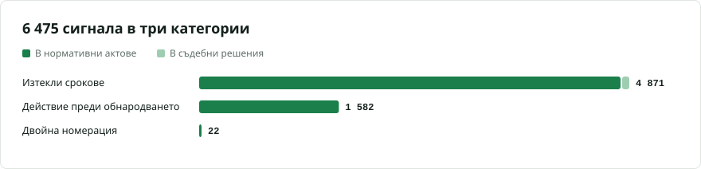

# Уязвимости в българското право

**Български** · [English](README.en.md)

<picture>
<source media="(prefers-color-scheme: dark)" srcset="img/flags-by-category-dark.bg.svg">

</picture>

Детекторите за уязвимости от хранилището [lexifina/global-law](https://github.com/lexifina/global-law/tree/main/vulnerabilities) търсят механични грешки в законодателството: правило, което все още се прилага „до“ дата, която е отминала, акт, който действа, преди да е обнародван, срок, удължен едва след като е изтекъл, препратка към разпоредба, която вече не съществува. Списъкът, който global-law публикува на 9 ноември 2026 г., не обхващаше България, затова това е проверка само на това хранилище, в състоянието му към commit [`7257fc3`](https://github.com/lexifina/bulgaria-law/commit/7257fc34e4a84bf62d70f593aa9511cdea76ea81) от 15 ноември 2026 г., с Конституцията, 17 367-те акта от „Държавен вестник“ от 2003 до 2026 г. и съдебните решения, проектите и обявленията за обществени консултации, които то също съдържа.

**Накратко:** детекторите подадоха 1 963 сигнала. Езиков модел прегледа 80 от най-силните, като за всеки изложи доводи за и против; 13 издържаха. След ръчна проверка в това хранилище един изглежда като действителна грешка при изготвянето на акт, макар и дребна и отдавна без значение. Инструкция № 8121з-282 от 2018 г. за служебните карти в МВР позволи контролните холограмни стикери за 2016 г. да се ползват до 30 юни 2018 г., но инструкцията, която тя замени, ги допускаше само до 31 декември 2017 г., а новата влезе в сила в деня на обнародването си, 23 март 2018 г., така че 81 дни никое правило не ги допускаше. От останалите 12 осем са постановления на Министерския съвет, чиито заключителни разпоредби сами определят ден преди обнародването (заплати, минималната работна заплата, издръжката на висшите училища, бюджетът за 2026 г.), а четири са изчерпани преходни правила. При проверката се установи още, че 49 закона са датирани в това хранилище три дни след деня на броя на „Държавен вестник“, а не на деня, който посочват собствените им заключителни разпоредби. По-късно това ще бъде формализирано в Lean, подобно на работата ни върху [данъчния кодекс на САЩ](https://lexifina.com/blog/formalizing-the-us-tax-code) и [съдебната практика на САЩ](https://lexifina.com/blog/formalizing-all-us-case-law-in-lean).

Сигналът е повод да се погледне по-отблизо, а не правен съвет, и нищо от изложеното тук не е проверявано пред съд.

## Сигнали по категории

| Категория | Какво търси | Сигнали | В нормативни актове | Прегледани | Издържали прегледа |
| --- | --- | ---: | ---: | ---: | ---: |
| Изтекли срокове | Текст, който все още прилага правило „до“ дата, която е отминала | 355 | 267 | 40 | 5 |
| Действие преди обнародването | Акт, който действа, преди да е издаден или обнародван | 1 582 | 1 582 | 40 | 8 |
| Двойна номерация | Две единици с един и същ номер в един акт | 22 | 22 | 0 | 0 |
| Валути извън обращение | Суми във валути, които вече не се използват | 4 | 4 | 0 | 0 |

„В нормативни актове“ обхваща законите и кодексите, постановленията на Министерския съвет, наредбите, правилниците, инструкциите, международните договори и другите актове от официалния раздел на „Държавен вестник“. Останалите сигнали са в решения на Конституционния съд и на Върховния административен съд, които хранилището също съдържа, отделно от правото, заедно с проекти и обявления за обществени консултации (по тях сигнали няма). Търсенето на празнини след отмяна, изменения в един и същи ден, празни периоди, остарели суми и препратки към отменени разпоредби не откри нищо: с изключение на Конституцията всеки акт тук има една редакция, текста си, както е приет, а измененията са отделни актове, така че в историята няма разпоредба, която да е изменена или отменена и която тези детектори да могат да сравнят.

*Гранични случаи: 13-те сигнала, които издържаха прегледа, групирани според това какво се оказаха, както и какво представляват останалите сигнали, в [EDGE-CASES.md](EDGE-CASES.md).*

## Проблеми, открити в това хранилище

- **Закони, датирани три дни след обнародването:** 49 закона, чиито заключителни разпоредби гласят „Законът влиза в сила от ... с изключение на ...“, са датирани три дни след деня на броя на „Държавен вестник“, а не на общия ден, който посочват, макар разделът „Дати“ в README на хранилището да предвижда именно него. При 39 от тях посоченият ден е по-късен, така че записът ги показва в сила, преди да са влезли; при 10 е по-ранен, сред тях законите за държавния бюджет за 2022, 2023, 2025 и 2026 г., които влизат в сила от 1 януари, а тук са датирани 7 март 2022 г., 4 август 2023 г., 30 март 2025 г. и 3 август 2026 г. (§ 48 от [закона за 2026 г.](https://github.com/lexifina/bulgaria-law/blob/7257fc34e4a84bf62d70f593aa9511cdea76ea81/zakon/2026/dv069-167157/art-014.md)). Затова тези 10 закона липсват и сред сигналите за действие преди обнародването.
- **Членове, останали в един файл:** в 12 закона разпоредбите след определен член остават във файла на този член: в законите за държавния бюджет за 2014, 2015 и от 2019 до 2026 г., в Закона за бюджета на държавното обществено осигуряване за 2013 г. и в Закона за виното и спиртните напитки. В бюджетния закон за 2026 г. [art-014.md](https://github.com/lexifina/bulgaria-law/blob/7257fc34e4a84bf62d70f593aa9511cdea76ea81/zakon/2026/dv069-167157/art-014.md) съдържа чл. 14 до чл. 115 и §§ 1 до 48, а в Закона за виното и спиртните напитки [art-123.md](https://github.com/lexifina/bulgaria-law/blob/7257fc34e4a84bf62d70f593aa9511cdea76ea81/zakon/2012/dv045-13789/art-123.md) съдържа чл. 123 до чл. 225.

## Файлове

| Файл | Какво съдържа |
| --- | --- |
| [data/flags.csv](data/flags.csv) | Всички сигнали, по един ред за разпоредба или акт и проблем |
| [data/reviewed.csv](data/reviewed.csv) | 80-те сигнала, прегледани от модела, с неговата оценка и мотиви |
| [data/by_category.csv](data/by_category.csv) | Броят от таблицата по-горе |
| [tools/](tools/) | Скриптовете, с които е направена проверката |

Колони: `category` и `category_bg` (категорията на английски и на български), `detector`, `kind` (`law` или `other`), `path` (файлът в това хранилище; празно при действие преди обнародването, което засяга целия акт), `date` (датата, към която се отнася сигналът), `reference` (засегнатият акт или ред), `summary`, `score` (класирането от детектора, от 0 до 1), `review` (`artefact`, `lawful` или `candidate_defect`), `survives_rebuttal`, `review_note` (мотивите на модела, на английски), `url` (разпоредбата в прочетения commit, а при действие преди обнародването – commit-ът на акта).

## Как е направено

- **Детектори:** [vulnerabilities/scripts](https://github.com/lexifina/global-law/tree/main/vulnerabilities/scripts) от global-law, пуснати върху това хранилище към commit `7257fc3`. Таблицата с историята, която детекторите четат, е изградена от собствените commit-и на хранилището (авторът, т.е. актът, направил всяка промяна, и трейлърите `In-force` и `Kind`); за право се смятат commit-ите от видовете `law`, `decree`, `as-enacted`, `court` и `publisher`.
- **Преглед от модел:** gpt-5.4-mini, 40-те най-силни сигнала във всяка категория, а при изтеклите срокове и 40-те най-силни в нормативни актове (тук същите 40); първото преминаване преценява дали сигналът е реален, второто доказва, че не е. Когато сигнал е прегледан два пъти, важи по-късният преглед. Собственият списък на global-law е използвал друг модел.
- **Ръчна проверка:** всеки случай, издържал прегледа, е прочетен в историята и текстовете на това хранилище, заедно с актовете, които той изменя или отменя, когато хранилището ги съдържа. Отвореният случай все още изисква справка в самия „Държавен вестник“.

За да съобщите корекция, отворете issue с разпоредбата и официален източник.

## Лиценз

Списъците и бележките са на Lexifina и са предоставени за обществено ползване под CC0 1.0, както и останалите собствени приноси на това хранилище. Цитираният текст е официален текст на нормативни актове, който в България не е обект на авторско право (Закон за авторското право и сродните му права, чл. 4, т. 1); вж. [LICENSE](../LICENSE).
